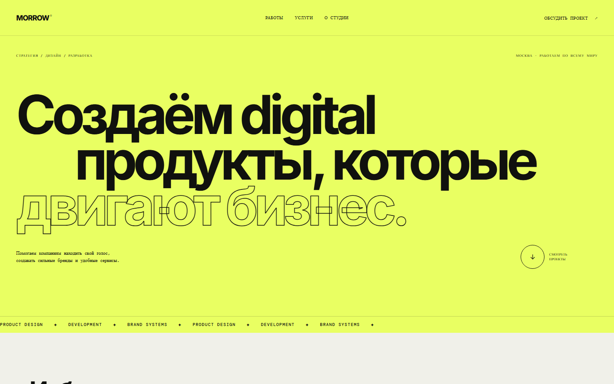
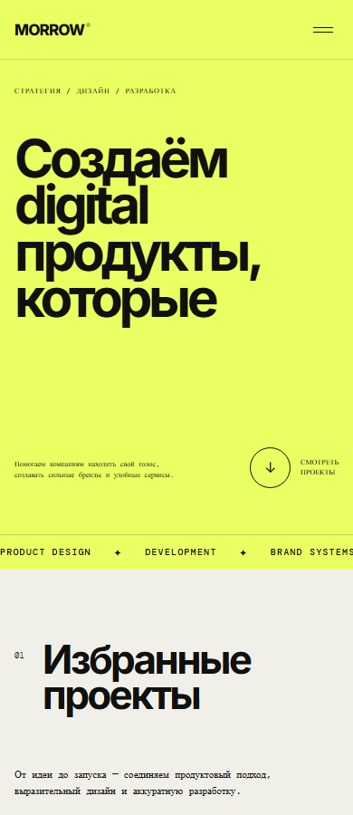

# Morrow Studio - сайт цифровой студии

Адаптивный сайт студии: проекты, фильтры, услуги, навигация и контактная форма.

[Открыть проект](https://memorim.github.io/morrow-studio-website/)





## Устройство проекта

HTML, CSS и JavaScript без сборщика. Фотографии сохранены в assets/photos, карточка цифрового продукта показывает макет интерфейса. Сайт можно обслуживать статическим HTTP-сервером. Сборка приложения и настройка секретов не требуются.

## Локальный запуск и проверки

Python 3.12.14, как в CI.

```bash
node --check script.js
python tests/check_assets.py
python .github/scripts/check_docs.py
python -m http.server 8080 --bind 127.0.0.1
```

Откройте `http://localhost:8080`. Карточки открывают краткое описание в диалоге. CI проверяет локальные изображения, документацию, синтаксис и браузерные сценарии.

Для браузерных проверок нужны Node.js 24.18.0 и pnpm 11.7.0:

```bash
pnpm install --frozen-lockfile
pnpm exec playwright install --with-deps --only-shell chromium
pnpm test:e2e
```

Playwright используется только при разработке: сайт остаётся статическим. Проверяются компьютерная, планшетная и мобильная ширина, фильтры, клавиатурный фокус диалога, локальная валидация формы и уменьшение движения. Меню работает до 900 px и закрывается Escape; `prefers-reduced-motion` отключает бегущую строку.

## Границы реализации

Форма проверяет данные локально и не отправляет письма или заявки на сервер. Фильтры и навигация работают в браузере.

База данных, миграции и API в текущем варианте не используются.

[Технические сведения](docs/TECHNICAL.md) · [Выполненные проверки](docs/VERIFICATION.md) · [История изменений](CHANGELOG.md)
