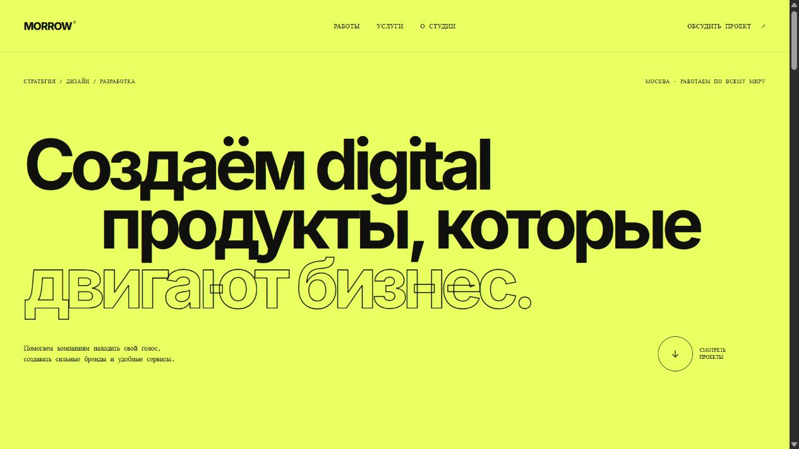

# Morrow Studio — сайт digital-студии

Одностраничный сайт независимой digital-студии. Проект показывает работу с типографикой, композицией, адаптивной сеткой и интерактивными состояниями без UI-фреймворков.



## Возможности

- адаптивная промо-страница от 320 px;
- четыре авторские CSS-композиции для кейсов;
- фильтрация проектов по направлению;
- бегущая строка, hover-состояния и плавная навигация;
- форма обратной связи с клиентской валидацией;
- семантическая HTML-разметка.

## Запуск

Откройте `index.html` в браузере или запустите любой статический сервер:

```bash
python -m http.server 8080
```

После этого сайт доступен по адресу `http://localhost:8080`.

## Демо

https://memorim.github.io/morrow-studio-website/
