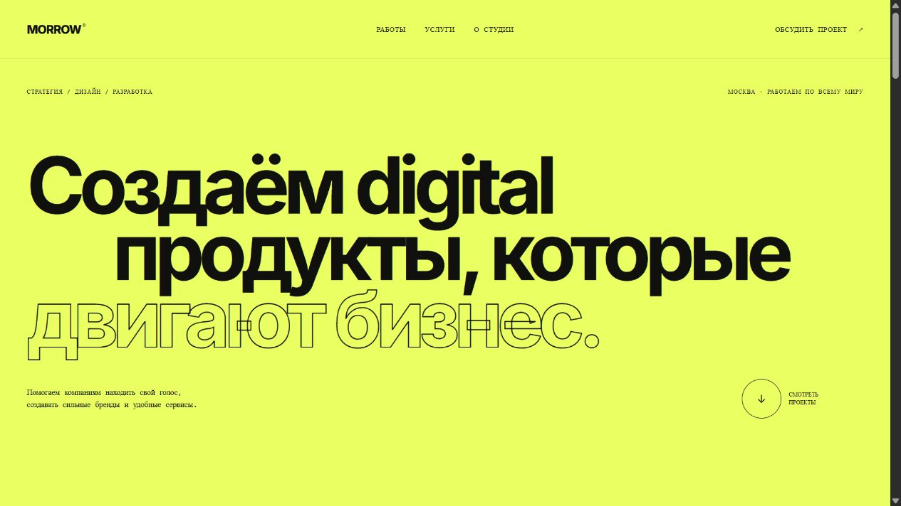

# Morrow Studio — сайт digital-студии

Одностраничный сайт независимой digital-студии. Проект показывает работу с типографикой, композицией, адаптивной сеткой и интерактивными состояниями без UI-фреймворков.



## Возможности

- адаптивная промо-страница от 320 px;
- четыре авторские CSS-композиции для кейсов;
- фильтрация проектов по направлению;
- бегущая строка, hover-состояния и плавная навигация;
- форма обращений с серверной валидацией и сохранением в PostgreSQL;
- семантическая HTML-разметка.

## Запуск

Укажите `DATABASE_URL` и запустите сервер из корня проекта:

```bash
pnpm install --frozen-lockfile
node server.js
```

После этого сайт доступен по адресу `http://localhost:4832`.

## Демо

https://memorim.github.io/morrow-studio-website/

## Текущий режим работы
Express отдаёт отфильтрованный каталог по параметру `category`. Обращения принимаются через `POST /api/inquiries`. Оператор читает их в таблице `morrow_inquiries` через закрытое подключение к PostgreSQL. Публичный API не выдаёт контакты. Карточки открывают описание концепций внутри страницы.
